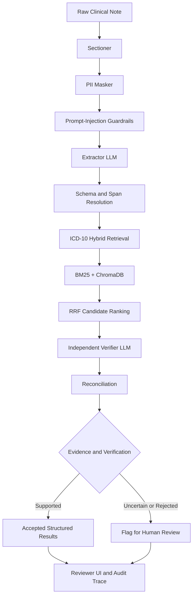

# AI-Powered Clinical Note Extraction & ICD-10 Coding Agent

**An evidence-grounded clinical documentation and coding assistant built with LLMs, hybrid retrieval, independent verification, and human-in-the-loop review.**

[](https://www.python.org/)
[](https://fastapi.tiangolo.com/)
[](#architecture)
[](#current-status)

## Overview

Clinical documentation workflows require medical information to be extracted from free-text notes and mapped to standardized codes such as ICD-10-CM. Manual processing is time-consuming, while unconstrained LLM-based automation can introduce unsupported diagnoses, misinterpret clinical context, or produce incorrect codes.

This project explores a more evidence-grounded approach.

The **Clinical Note Extraction & ICD-10 Coding Agent** processes clinical notes, extracts structured medical entities, retrieves relevant ICD-10 candidates, and independently verifies extracted information before presenting the results for human review.

The central design principle is simple:

> Every accepted extraction should be traceable to evidence in the original clinical note. Uncertain or unsupported results should be flagged rather than silently accepted.

The system is an MVP intended for evaluation and human-reviewed workflows. Its current evaluation results and limitations are documented below; it is not a clinically validated autonomous coding system.


## 🚀 Live Demo

**Try the deployed application:** [Clinical Note Extraction & ICD-10 Coding Agent](https://clinical-note-agent-shaswat-huf9hqdwaxbtbgbp.centralindia-01.azurewebsites.net/)

The application is deployed on Microsoft Azure App Service. Explore the reviewer interface to see the clinical note extraction and ICD-10 coding workflow.

> **Note:** The demo runs on a free-tier instance, so initial loading may take some time. This is an experimental MVP; outputs require human review.


## Key Features

- **Structured clinical extraction:** Extracts diagnoses, medications, procedures, allergies, and vital signs into structured output.
- **Evidence-grounded results:** Associates extracted items with verbatim source quotes and character offsets into the original note.
- **PII masking:** Applies regex-based and spaCy-assisted masking before sending note content to LLMs.
- **Prompt-injection guardrails:** Applies defensive handling to clinical note content before model processing.
- **Hybrid ICD-10 retrieval:** Combines BM25 lexical search and ChromaDB vector retrieval, with Reciprocal Rank Fusion (RRF) for candidate ranking.
- **Independent verification:** Uses a separate verifier model to assess extracted items against the source evidence.
- **Fail-closed reconciliation:** Flags unsupported, rejected, or conflicting items for human review.
- **Reviewer interface:** Provides an interface for inspecting pipeline results and reviewing flagged items.
- **Caching:** Uses local LLM response caches and an optional Redis-backed whole-note result cache.
- **Evaluation tooling:** Includes a gold-labelled dataset, precision/recall/F1 calculations, tests, and evaluation scripts.

## Architecture

The pipeline separates model-generated proposals from code-enforced validation and independent verification.



### Pipeline stages

| Stage | Responsibility |
|---|---|
| Sectioning | Detects note sections while preserving character offsets. |
| PII masking | Masks identifiable information using regex and spaCy-assisted processing. |
| Guardrails | Applies defensive handling of untrusted note content. |
| Extraction | Produces structured clinical entities with source quotes. |
| Span resolution | Resolves quotes to character offsets in the original note. |
| ICD-10 retrieval | Retrieves candidate codes using lexical and semantic similarity. |
| Verification | Independently checks extracted items against the note. |
| Reconciliation | Determines which items can be accepted and which require review. |
| Reviewer UI | Presents results for human inspection and review. |

For the detailed design and implementation decisions, see [ARCHITECTURE.md](./ARCHITECTURE.md).

## Technology Stack

| Component | Technology |
|---|---|
| Language | Python |
| API and backend | FastAPI |
| Structured validation | Pydantic |
| Extraction and verification | LLM APIs |
| Extraction provider | Groq |
| Verification provider | Google AI Studio |
| Lexical retrieval | BM25 / `rank_bm25` |
| Vector database | ChromaDB |
| Embeddings | Sentence Transformers — `BAAI/bge-small-en` |
| PII masking | Regex and spaCy |
| Whole-note result cache | Redis, optional |
| Local LLM response cache | Disk-based cache |
| Testing | pytest |
| Deployment | Azure App Service |
| CI/CD | GitHub Actions |

See [TECH_STACK.md](./TECH_STACK.md) for the project's documented technology choices and alternatives.

## Repository Structure

```text
.
├── src/
│   ├── schema.py
│   ├── sectioner.py
│   ├── masker.py
│   ├── guardrails.py
│   ├── extractor.py
│   ├── verifier.py
│   ├── icd_index.py
│   ├── orchestrator.py
│   ├── prompts/
│   ├── eval/
│   ├── ui/
│   ├── cache/
│   ├── advice/
│   └── utils/
├── data/
│   ├── mtsamples.csv
│   ├── icd10cm_data.csv
│   └── note_*.txt
├── gold/
│   └── Hand-labelled annotations
├── eval_sets/
│   └── Specialized evaluation cases
├── chroma_db/
│   └── Persisted vector index
├── docs/
│   ├── ARCHITECTURE.md
│   ├── TECH_STACK.md
│   ├── FINDINGS.md
│   ├── eval_baseline.md
│   └── labelling_guidelines.md
├── tests/
├── requirements.txt
├── .env.example
├── README.md
├── LEARNING.md
└── PREP_360.md
```

*Note: This is a logical overview of the repository. Some documentation or directories may be present only in the current development version.*

## Quick Start

### 1. Prerequisites

- Python 3.10 or newer, compatible with the pinned dependencies
- Git
- A Groq API key
- A Google AI Studio API key
- Sufficient RAM and disk space for the embedding model and retrieval indexes

### 2. Clone the repository

```bash
git clone <YOUR_REPOSITORY_URL>
cd <YOUR_REPOSITORY_DIRECTORY>
```

### 3. Create and activate a virtual environment

**Windows — PowerShell**

```powershell
python -m venv .venv
.\.venv\Scripts\Activate.ps1
```

**macOS / Linux**

```bash
python3 -m venv .venv
source .venv/bin/activate
```

### 4. Install dependencies

```bash
python -m pip install --upgrade pip
pip install -r requirements.txt
python -m spacy download en_core_web_sm
```

### 5. Configure environment variables

Copy `.env.example` to `.env` and fill in the required credentials.

```dotenv
GROQ_API_KEY=your_groq_api_key
GOOGLE_API_KEY=your_google_ai_studio_api_key
```

Add any additional variables required by the current configuration, such as Redis settings, if you intend to use those features.

**Never commit `.env` or API credentials to Git.** Keep `.env.example` limited to variable names and safe placeholder values.

### 6. Prepare the ICD-10 index

If the repository does not already contain usable, compatible index artifacts, build them using the project's index builder:

```bash
python -m src.icd_index --build
```

This process reads the ICD-10-CM source data and prepares the lexical and vector retrieval indexes. Initial embedding generation can take substantial time on a CPU.

Do not rebuild the index unnecessarily if the required artifacts are already present and valid.

### 7. Run a pipeline smoke test

```bash
python -m src.utils.try_pipeline
```

This exercises the pipeline against the configured sample note. Check the output and logs for initialization, extraction, retrieval, and verification errors.

### 8. Start the web application

```bash
python -m uvicorn src.ui.app:app --host 127.0.0.1 --port 8000
```

Open the reviewer interface at:

http://127.0.0.1:8000/reviewer

Use synthetic or appropriately de-identified notes for development and demonstrations.

## Evaluation

The project includes a hand-labelled gold dataset and an evaluation harness for comparing extracted entities with expected annotations.

### Current reported baseline

**Raw extractor — 42 gold-labelled notes, without the verifier**

| Entity | Precision | Recall | F1 |
|---|---:|---:|---:|
| Diagnoses | 0.655 | 0.800 | 0.720 |
| Medications | 0.550 | 0.635 | 0.589 |
| Procedures | 0.429 | 0.698 | 0.531 |
| Vitals | 0.147 | 0.167 | 0.156 |

**Verifier applied — 5-note evaluation subset**

| Entity | Precision | Recall | F1 |
|---|---:|---:|---:|
| Diagnoses | 0.778 | 0.583 | 0.667 |
| Medications | 0.667 | 0.667 | 0.667 |

The verifier results are from a much smaller subset and should not be directly compared with the 42-note raw-extractor baseline as if they were a controlled, same-dataset comparison.

### Run evaluation

```bash
# Raw extractor
python -m src.eval.run_eval 42 60

# With verification
python -m src.eval.run_eval 42 60 --verify
```

The first argument specifies the note limit; the second specifies pacing in seconds between requests to help respect API rate limits.

See [docs/eval_baseline.md](./docs/eval_baseline.md) for additional evaluation results and analysis.

## Known Limitations

The project is an MVP, and the current evaluation shows important gaps.

- **Vitals extraction:** The reported F1 is approximately 0.16, indicating weak extraction quality.
- **Procedure precision:** The extractor can classify routine examination components as procedures.
- **Limited gold dataset:** The reported baseline uses 42 labelled notes; the project target is 100.
- **Limited verifier category coverage:** The documented verifier category check covers diagnoses and medications, not all entity types.
- **Adversarial evaluation:** The README's earlier status reports that the adversarial test set is pending. Verify the current evaluation artifacts before claiming completion.
- **API rate limits:** Free-tier API limits can constrain batch evaluation and require request pacing.
- **Resource requirements:** Initial model loading and index creation require memory, disk space, and CPU time.
- **Clinical validation:** The available results do not establish clinical safety, coding accuracy sufficient for production, or readiness for autonomous use.

The system should remain a human-reviewed aid. Results must be checked by qualified personnel before being used for clinical documentation or billing.

## Caching

The project has two distinct caching mechanisms.

### Local LLM response cache

The extractor and verifier cache model responses on disk. Cache keys incorporate model and prompt-related inputs so that relevant prompt or schema changes can invalidate previous responses.

### Redis whole-note result cache

The optional Redis cache stores complete pipeline results using a key derived from the note ID, prompt fingerprint, and note text. Entries expire after 24 hours.

When Redis is unavailable, the application is designed to continue without the Redis result cache.

To inspect cache statistics while the local application is running:

```bash
curl http://127.0.0.1:8000/api/cache/stats
```

The exact cache behavior depends on the current configuration and implementation. Do not assume the Redis cache is enabled in a deployed environment until its connection and cache-hit behavior have been verified.

## Deployment

The application has been configured for Azure App Service using Python and a GitHub Actions deployment workflow.

Deployment requires the source code, compatible Python dependencies, required index artifacts, and valid application settings. Model initialization and index loading can make cold startup significantly slower than a lightweight API.

For hosted deployments:

- Configure API keys through the platform's environment settings.
- Never commit credentials or production secrets.
- Confirm that the ICD-10 index is available and loads successfully.
- Verify startup logs and health of the reviewer interface.
- Test an end-to-end request rather than relying solely on a successful deployment status.
- Confirm the actual hosting plan and associated costs before assuming a deployment is free.

## Project Status

The project was developed against the Mirai Labs Statement of Work for the Clinical Note Extraction & ICD-10 Coding Agent MVP.

The documented status includes implemented extraction, retrieval, verification, orchestration, and evaluation components, alongside outstanding evaluation and quality gaps. Check the latest repository documentation before treating any milestone as complete.

The primary references are:

- [ARCHITECTURE.md](./ARCHITECTURE.md) — system design and data flow
- [TECH_STACK.md](./TECH_STACK.md) — technology decisions and alternatives
- [docs/FINDINGS.md](./docs/FINDINGS.md) — issues, experiments, and findings
- [docs/eval_baseline.md](./docs/eval_baseline.md) — metrics and evaluation gaps
- [docs/labelling_guidelines.md](./docs/labelling_guidelines.md) — gold annotation rules
- `LEARNING.md` — technical learning guide, if present
- `PREP_360.md` — technical review preparation, if present

## Security and Confidentiality

Clinical notes can contain highly sensitive personal information. Use synthetic or appropriately de-identified data for demonstrations and development.

PII masking and prompt-injection defenses are safeguards, not guarantees that all sensitive information will be removed or all attacks prevented.

The project was developed for Mirai Labs. Confirm the applicable confidentiality requirements and obtain any required permission before making the repository, implementation details, evaluation data, or project artifacts publicly accessible.

## Future Improvements

Potential next steps, subject to evaluation and project requirements:

- Expand the gold dataset to the target size and improve annotation coverage.
- Improve vitals and procedure extraction using error analysis and targeted tests.
- Expand verifier checks to cover additional entity categories.
- Complete and run contradiction, rare-diagnosis, and adversarial evaluation sets.
- Measure precision, recall, F1, latency, and failure rates across a consistent evaluation set.
- Improve observability for retrieval, verification, caching, and external API failures.
- Verify secure deployment configuration and resource requirements.
- Evaluate performance on representative, appropriately governed clinical data before considering production use.

## Acknowledgements

Developed as an MVP for the Mirai Labs clinical note extraction and ICD-10 coding project.

---

**Disclaimer:** This project is an experimental software MVP for human-reviewed clinical documentation workflows. It is not a substitute for professional clinical judgment, and its outputs should not be used for autonomous diagnosis, treatment, or billing decisions without appropriate validation and review.
